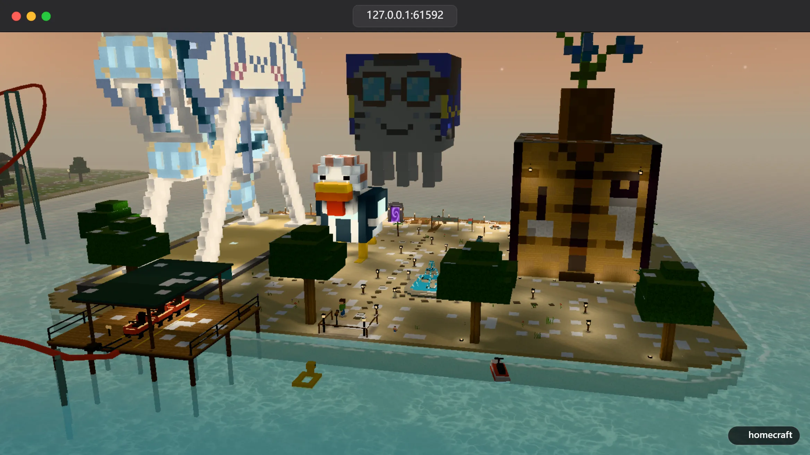
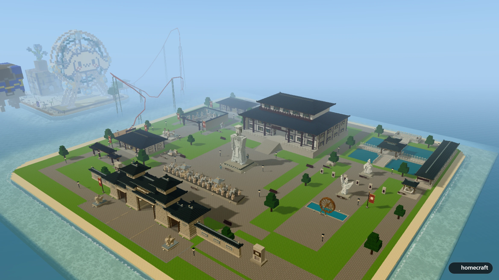
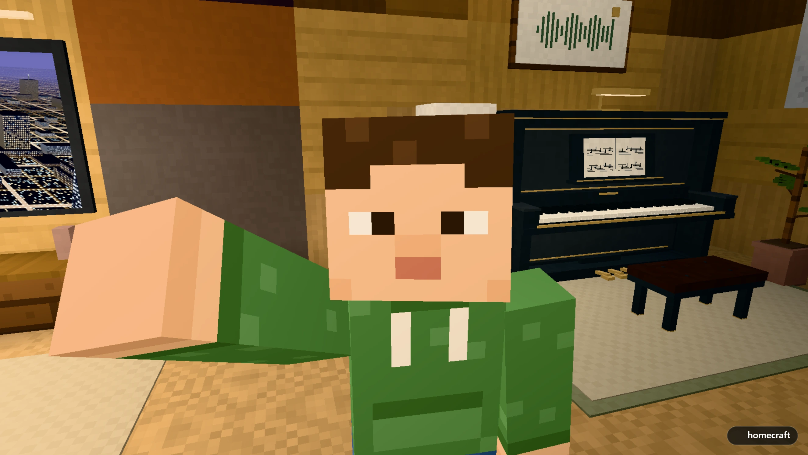
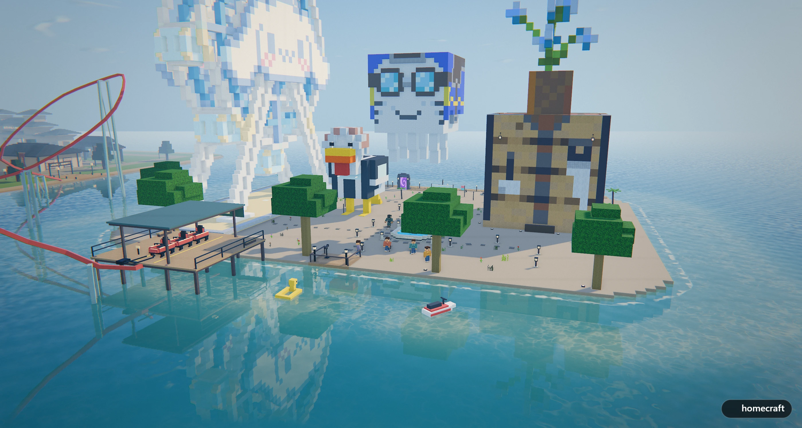
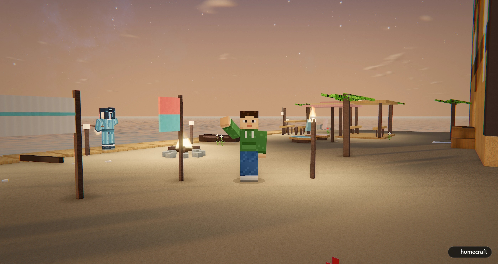
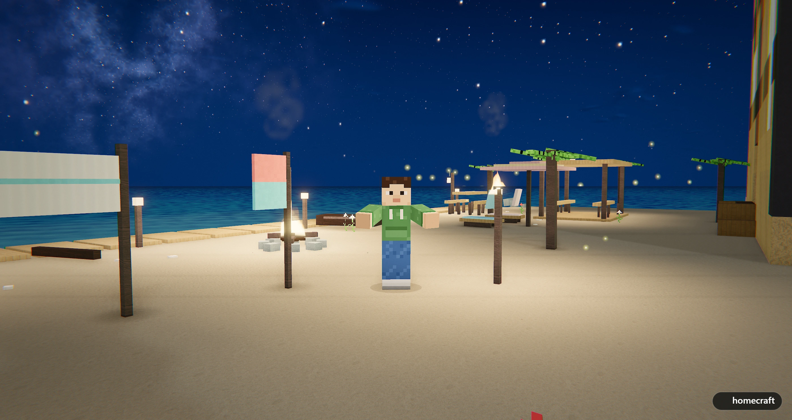
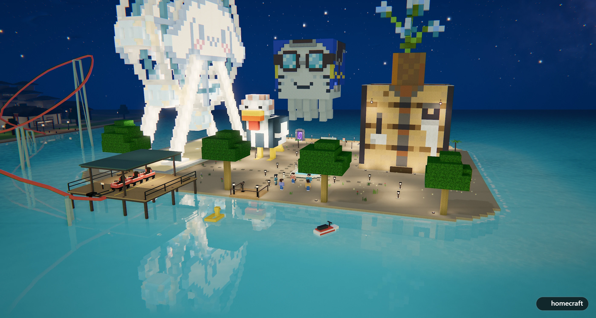
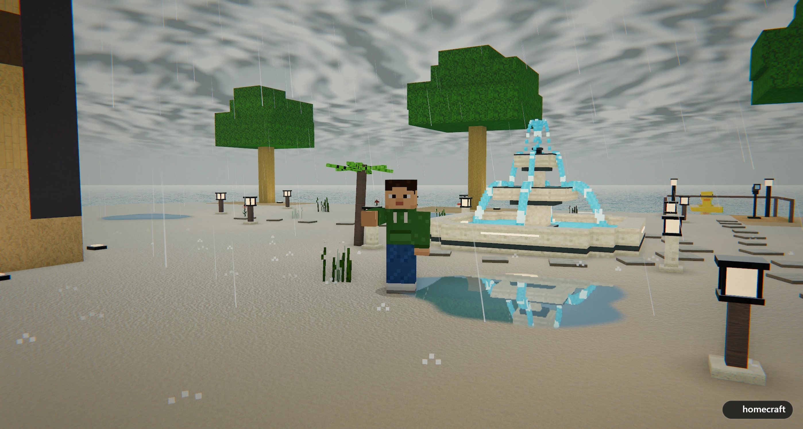
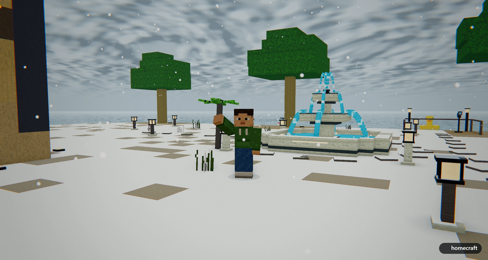
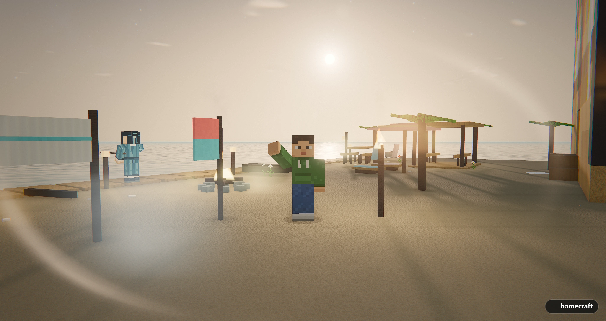

# Homecraft — Wyc Home

[中文](README.md) · **English**

## About

A personal website built as an explorable 3D world with Homecraft and Three.js. Its Minecraft-inspired islands bring the site content into the world: wander the sandy home island, swim along the coast, and visit Qin Island, inspired by Qinhuangdao's maritime quest-for-immortality heritage. Explore its palace, Great Wall gallery and seaside scenery. Day, night and changing weather keep the world in motion; switch between normal and HD materials when you like. Projects, profile and guestbook pages remain accessible in-world, on desktop and mobile.

## In-game screenshots · [Visit Wyc Home](https://www.wyc21.com/)

### Normal materials

| Home island | Qin Island | Piano room |
| :---: | :---: | :---: |
|  |  |  |

### HD materials

| Day | Dusk | Night |
| :---: | :---: | :---: |
|  |  |  |

| Night view | Rain | Snow |
| :---: | :---: | :---: |
|  |  |  |

<p align="center"></p>

### Run locally

No build step is required. From the project directory, run:

```sh
python3 tools/serve.py
```

On Windows, use `python tools/serve.py`. The script finds an available port and opens the site in your browser. Main customization points are `world/`, `index.html`, `home.config.js` and `homecraft.json`.


## Links

- [Visit Wyc Home](https://www.wyc21.com/)
- [Homecraft project and listing requests](https://github.com/terryHu7/homecraft)
- [LINUX DO](https://linux.do)
