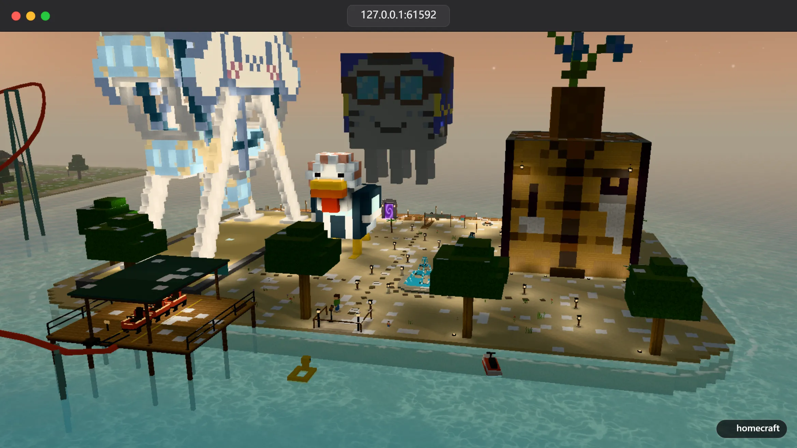
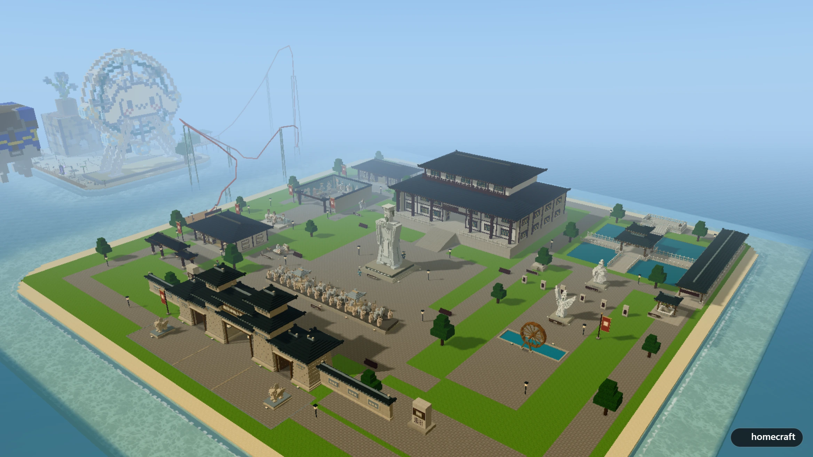
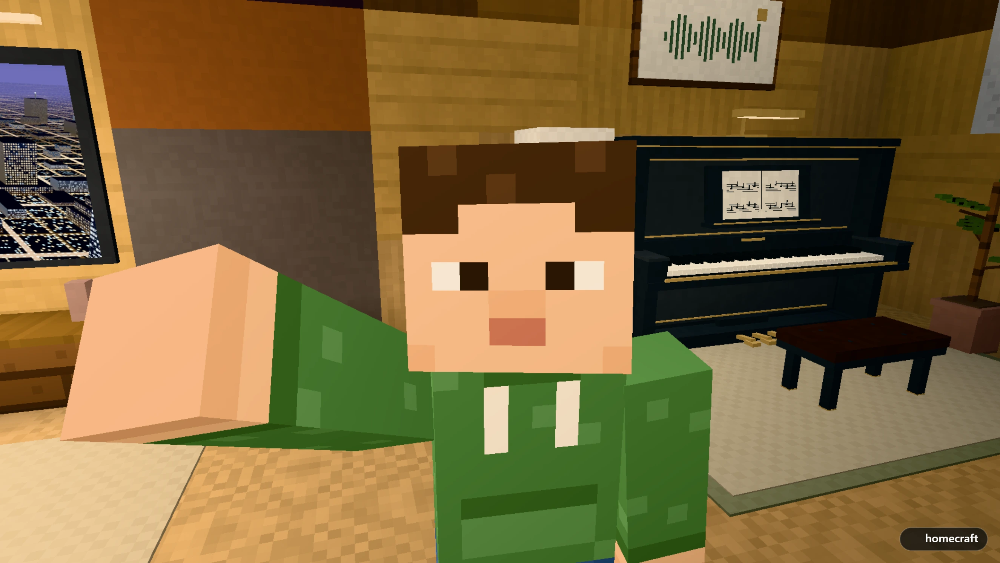
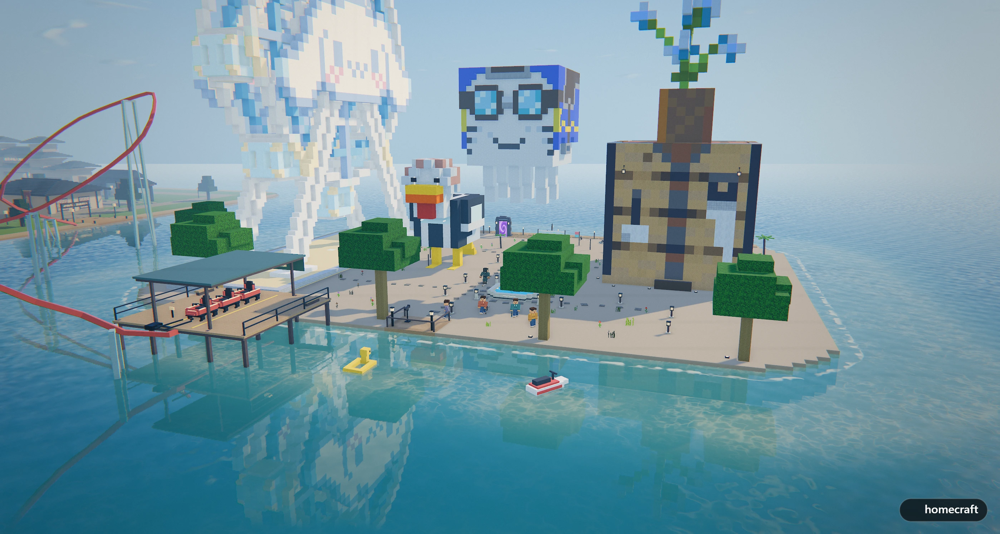
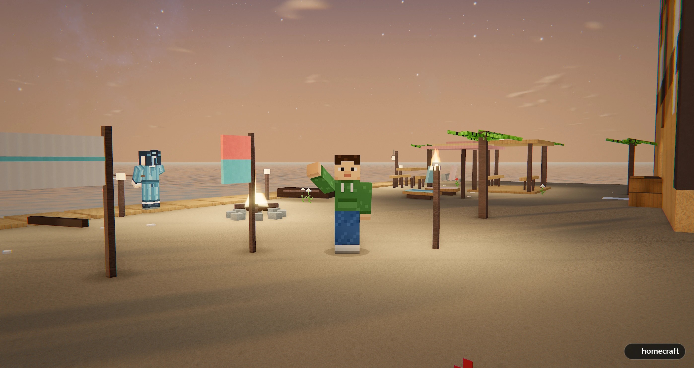
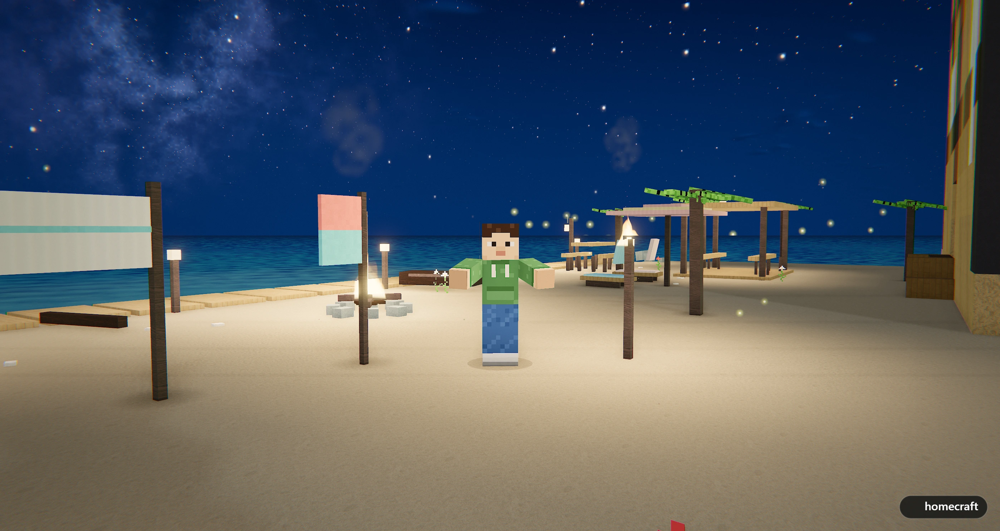
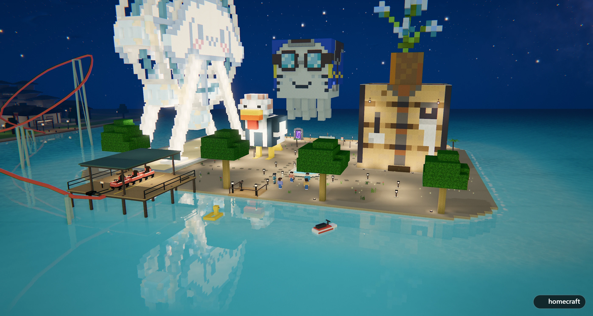
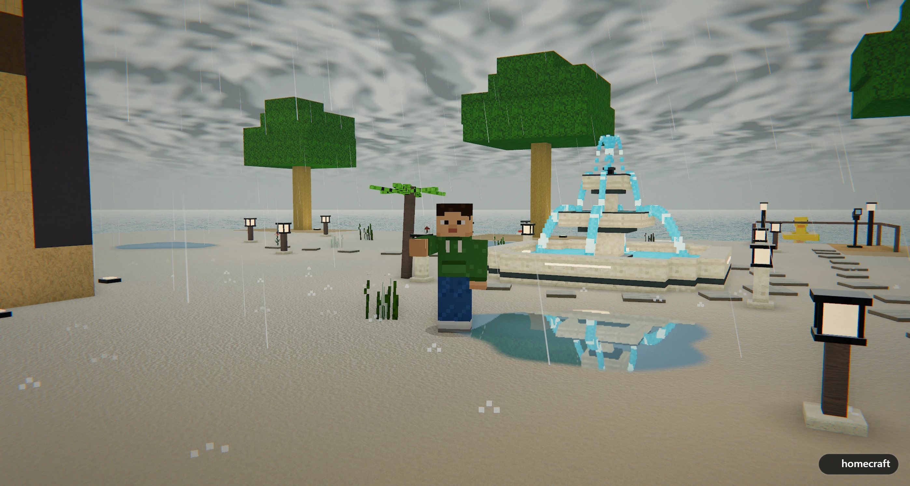
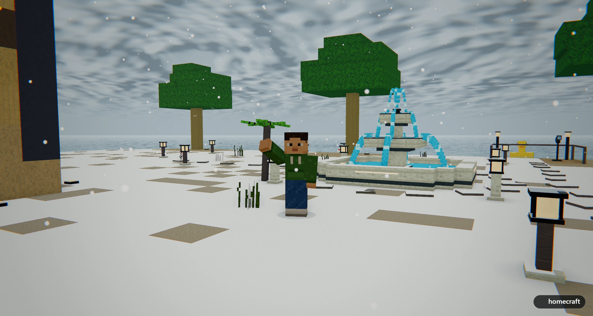
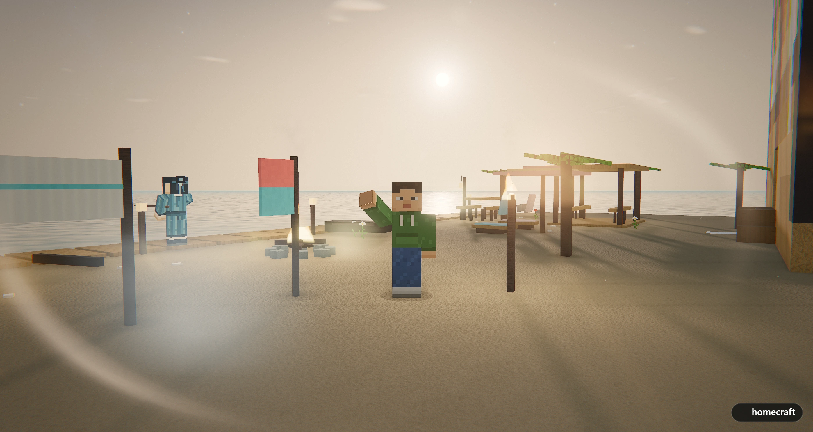

# Homecraft · Wyc 的世界

**中文** · [English](README.en.md)

## 项目简介

这是一个基于 Homecraft 与 Three.js 打造的可探索个人主页。我把网页内容融入一座 Minecraft 风格的 3D 海岛：你可以在沙岛漫步、沿海游泳，再前往受秦皇岛求仙文化启发的秦岛，探索宫殿、长城展馆与海滨景观。昼夜和天气让世界不断变化，普通与高清材质可以按需切换；作品、个人介绍和留言则能通过游戏内页面访问。电脑和手机都可以直接游览。

## 实机截图 · [访问 Wyc 的世界](https://www.wyc21.com/)

### 普通材质

| 沙岛 | 秦岛 | 钢琴空间 |
| :---: | :---: | :---: |
|  |  |  |

### 高清材质

| 白天 | 黄昏 | 夜晚 |
| :---: | :---: | :---: |
|  |  |  |

| 夜景 | 雨天 | 雪天 |
| :---: | :---: | :---: |
|  |  |  |

<p align="center"></p>

### 本地预览

项目无需构建步骤。在项目目录运行：

```sh
python3 tools/serve.py
```

Windows 用户使用 `python tools/serve.py`。脚本会自动选择可用端口并打开浏览器。主要自定义入口是 `world/`、`index.html`、`home.config.js` 和 `homecraft.json`；


## 相关链接

- [在线体验：Wyc 的世界](https://www.wyc21.com/)
- [Homecraft 项目与申请收录](https://github.com/terryHu7/homecraft)
- [LINUX DO](https://linux.do)
